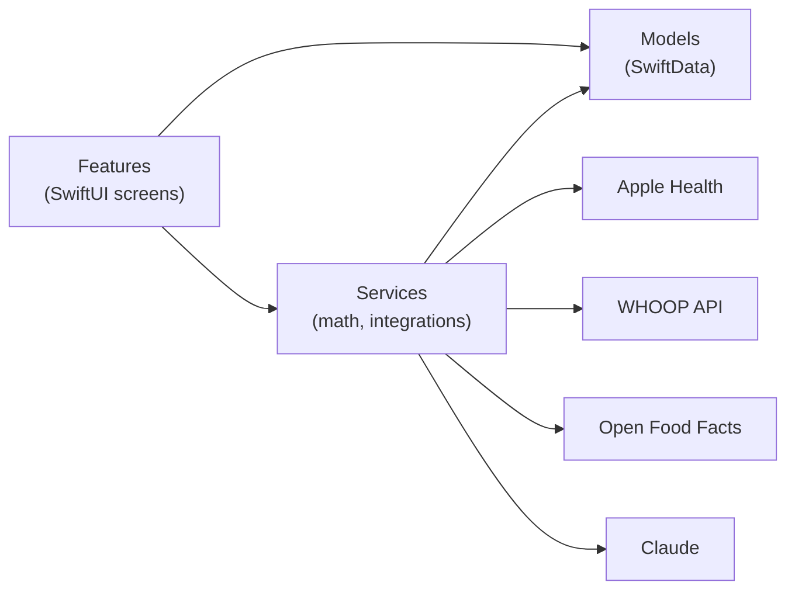

# Fitness App

A personal iOS app for strength training, nutrition, body measurements and recovery, built with SwiftUI and SwiftData. Everything is stored on the device. Data from Apple Health and WHOOP is pulled in and combined into one daily overview.


> Health and nutrition numbers in this app are estimates, not medical advice.

## Features

### Today
- Sleep, recovery and strain rings, in the style of WHOOP.
- Data from Apple Health and the WHOOP API (recovery, HRV, resting heart rate, sleep, SpO₂, skin temperature, strain).
- Trends with 7/30/90-day charts. Tap or drag on any chart to see the exact value for a day.
- Strength progress: estimated 1RM per exercise, % change and weekly tonnage.

### Workouts
- Mesocycles with workout templates, rep ranges per set and planned weights.
- Workout logging with a rest timer, notes, and last session's numbers shown as hints.
- One tap to start with last session's weights and reps.
- New-record alerts, warm-up sets (40/60/80 %), RIR per set and supersets.
- Plate calculator and a records page per exercise.
- "Next mesocycle" carries the best results and last weights forward.
- Import of a coach's Excel program, bundled as JSON.

### Nutrition
- Food diary by meal, with saved foods and amounts that recalculate calories and macros.
- Food search through Open Food Facts.
- Intake logged in other apps (e.g. MyFitnessPal) is added via Apple Health.
- Calorie and macro targets from the profile. Optional variable intake: higher on training days, lower on rest days.

### Body
- Weight with a 7-day trend.
- Circumferences: left and right sides, relaxed and flexed.
- Calculators: BMI, body-fat estimates, BMR, TDEE and macros.
- Progress photos by pose (front, side, back), imported from the photo library or a folder, with side-by-side comparison.

### AI coach
- A chat that sees sleep, recovery, workouts, weight, goals and remaining macros, and gives coaching advice.
- **Without an API key:** the data (and photos for the weekly review) are shared to the Claude app.
- **With a Claude API key:** stored in the Keychain, it answers in the app and can log food and weight from plain text.
- A weekly review of photos, weight, measurements, training volume and progress.

## Tech stack

| Area | Technology |
| --- | --- |
| UI | SwiftUI, Swift Charts |
| Storage | SwiftData (on-device, offline) |
| Health data | HealthKit (read-only) |
| Wearables | WHOOP API v2 (OAuth 2.0); Polar AccessLink (prepared, not in use) |
| Food data | Open Food Facts |
| AI | Claude Messages API (optional) or the Claude app via the share sheet |
| Secrets | iOS Keychain |

## Architecture



- **Features** contains the screens, one folder per tab.
- **Services** holds logic with no UI: formulas, sync and API clients.
- **Models** holds the SwiftData types. New properties always get a default value, so the store migrates automatically.

## Project structure

```
FitnessApp/
├── App/            App entry point and tab bar
├── Models/         SwiftData models (workouts, body, nutrition, photos, metrics, AI chat)
├── Services/       BodyMath, RecoveryMath, WorkoutMath, HealthService, WhoopService,
│                   FoodSearch, AIAssistant, ClaudeService, PhotoImport, Keychain, ...
├── Features/
│   ├── Today/          Daily overview, metric details, trends
│   ├── Workouts/       Mesocycles, templates, active workout, records, strength progress
│   ├── Nutrition/      Food diary and food search
│   ├── Measurements/   Weight, circumferences, profile, calculators
│   ├── Photos/         Progress photos and comparison
│   ├── AI/             AI coach chat
│   └── Devices/        WHOOP and Polar connection
└── Resources/      Bundled data (imported mesocycle)
FitnessAppTests/    Unit tests for the math (Swift Testing)
tools/              Pre-release checks and Excel-to-JSON converter
docs/               Requirements and architecture (Bulgarian)
```

## Getting started

Requirements: a Mac with Xcode 26 or later, and an iPhone on iOS 26 or later.

1. Clone the repository and open `FitnessApp.xcodeproj`.
2. Under **Signing & Capabilities**, choose your team. A free Personal Team works.
3. Connect the iPhone, enable **Developer Mode**, and press **Run**.
4. On first launch, trust the developer under **Settings → General → VPN & Device Management**.

With a free Apple ID the app has to be re-run from Xcode every 7 days. Data is kept. Step-by-step instructions in Bulgarian: [docs/INSTALL.bg.md](docs/INSTALL.bg.md).

### Optional integrations
- **WHOOP:** create an app in the WHOOP developer dashboard with redirect `http://localhost:8000/callback`, then enter the client ID and secret under Profile → Devices → WHOOP.
- **Claude API:** enter an API key in the AI chat settings. Without one, the chat uses the Claude app.

## Privacy

- All data stays on the device in SwiftData. There is no backend.
- Apple Health is read-only.
- API keys and tokens are kept in the iOS Keychain and never committed to the repository.
- Data leaves the phone only when you use an integration: WHOOP, Open Food Facts search, or the AI coach.

## Development

- Each app change is a numbered version (`vN`). It gets a line in [CHANGELOG.md](CHANGELOG.md), and the version is shown at the bottom of the Workouts tab.
- `bash tools/precheck.sh` runs quick checks before a release.
- [CLAUDE.md](CLAUDE.md) holds the working rules for the AI assistant that writes the code.

## Roadmap

- [ ] Home screen widget with remaining calories and macros
- [ ] Data export and import (backup)
- [ ] English UI (currently Bulgarian)
- [ ] Cloud sync and coach mode
- [ ] TestFlight distribution

## License

Personal project. All rights reserved.
